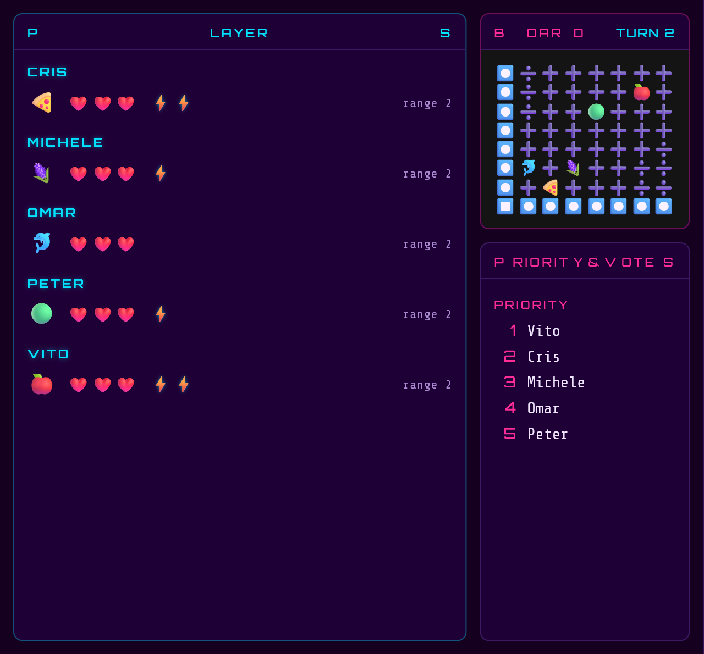

# Token Tactics

Deterministic token-based multiplayer board game. Feed it a text list of
commands and it computes the final board state.

## Run

```sh
python -m token_tactics          # run commands.txt once, print final state
python -m token_tactics --ascii  # ASCII palette (no emoji support)
python -m token_tactics --watch  # auto-refresh on commands.txt changes
python -m token_tactics --ui     # open the browser editor UI
```

## Commands

`PLAYER`, `TOKEN`, `RANDOM_SEED`, `BOARD_SIZE`, `next_turn`, `move`, `gift`,
`shoot`, `heal`, `upgrade`, `capture`, `vote`, plus cost params
(`MOVE_COST`, `SHOOT_COST`, ...). See `commands.txt` for an example.

## Board state



## Use as a library (UI)

```python
from token_tactics import run_game_from_text, Game

game, state, report = run_game_from_text("# Players\nPLAYER Alice\n...")
```
